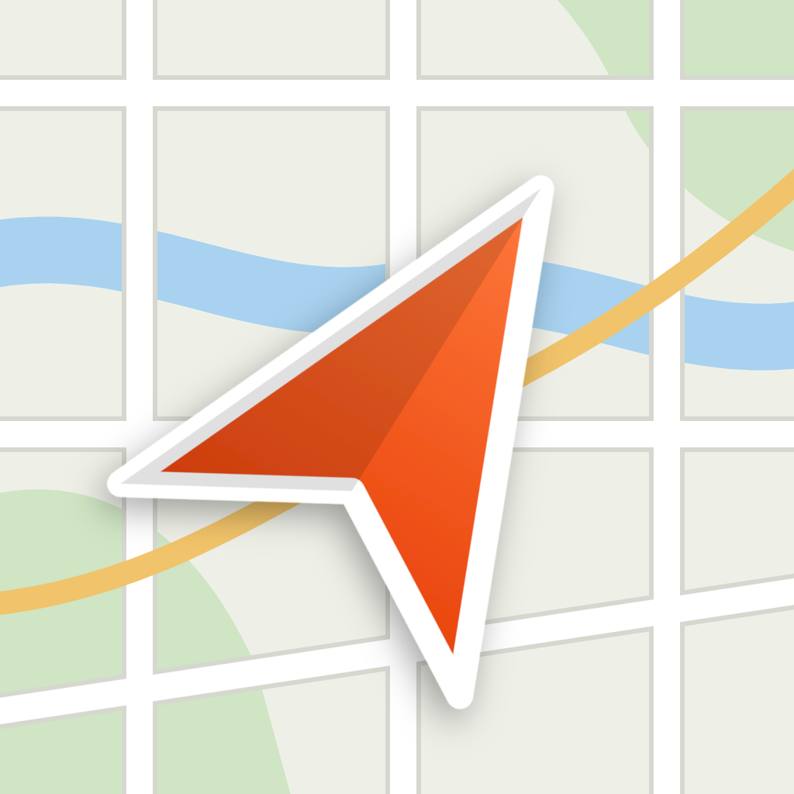

<p align="center">
  
</p>

# Trace 3D (Flutter)

Application mobile (Android + iOS) qui lit un fichier **GPX** ou **TCX** et affiche le parcours sur une carte **3D avec relief**, avec un survol animé du tracé que l'on peut enregistrer en **vidéo**.

## Fonctionnalités

### Carte et statistiques
- carte 3D (relief, ombrage, ciel), fond **satellite** ou **plan**
- statistiques : distance, vitesse moyenne / max, dénivelé + / −, altitude min / max, durée en mouvement
- profil d'altitude

### Survol 3D
- survol animé le long du tracé (type « fly-through » Strava / Komoot), vitesse **x1 / x2 / x5 / x10 / x15**
- caméra lissée : trajectoire rééchantillonnée, cap lissé selon la distance parcourue, fondu d'entrée
- **cycliste 3D** (rendu three.js) qui pédale : vu de dos par défaut, **de profil dans les virages serrés** quand la caméra n'est pas encore derrière lui ; il est posé au départ dès que la trace est chargée
- repère de départ (point de la couleur de la trace, blanc à l'intérieur) et d'arrivée (**drapeau à damier 3D**)
- **villes traversées** : quand le cycliste approche du centre d'une ville, d'un bourg ou d'un village, un repère 3D rouge qui tourne apparaît avec le nom en gras ; après le dézoom final il ne reste que les noms

### Vidéo
- bouton caméra : enregistre le survol (H.264, ≤ 1280 px) et le range dans la **galerie** du téléphone
- le cycliste attend au départ, de profil, pendant que la caméra zoome sur lui, puis démarre
- bandeau du bas, presque transparent : distance, vitesse et dénivelé au point courant, plus le **graphe d'altitude** qui se remplit
- en fin de vidéo : la carte se recadre et une carte centrale zoome sur la distance totale, la **vitesse moyenne**, le dénivelé et le profil complet

### Réglages (menu latéral)
- couleur et largeur du tracé
- repère : cercle ou cycliste, et couleur du cycliste

## Installation

**Android sans compiler** : télécharge l'APK de la dernière version dans l'onglet [Releases](https://github.com/Mahfoud047/trace_3d/releases) et ouvre-le sur le téléphone (autoriser l'installation d'applications inconnues). Pour construire l'APK soi-même : `bash tool/build_apk.sh`.

Depuis les sources :

```bash
git clone https://github.com/Mahfoud047/trace_3d.git
cd trace_3d
flutter pub get
flutter run            # ou: flutter run -d <id>  (voir `flutter devices`)
```

Si une dépendance pose problème de version : `flutter pub upgrade --major-versions`.

### Android : notes de build

- `android/build.gradle.kts` force `compileSdk` 36 sur les plugins (`file_picker` est compilé en 34 alors que `flutter_plugin_android_lifecycle` exige 36). À retirer quand les plugins seront à jour.
- Xiaomi / MIUI : activer **Options pour les développeurs → Installer via USB** (et le débogage USB), sinon l'installation échoue avec `INSTALL_FAILED_USER_RESTRICTED`.

### Android : autoriser Internet en release

Dans `android/app/src/main/AndroidManifest.xml`, ajoute avant `<application>` :

```xml
<uses-permission android:name="android.permission.INTERNET"/>
```

Internet sert aux tuiles de carte, à la bibliothèque three.js (chargée depuis un CDN) et à la recherche des villes.

### Tester

Le fichier `sample/demo.gpx` est une boucle de démonstration près de Grenoble. Copie-le sur le téléphone (Fichiers / Drive) puis ouvre-le depuis l'app.

## Utilisation

1. Ouvrir un fichier GPX / TCX (bouton dossier) : la trace s'affiche, le cycliste est au départ.
2. Choisir la vitesse (x1 … x15) puis lancer le survol, ou appuyer sur la caméra pour l'enregistrer en vidéo.
3. Le menu latéral règle les couleurs, la largeur et le type de repère.

## Icône

Le logo (plan de carte et tête de flèche de navigation) est dans `assets/logo.svg` (source) et `assets/logo.png` (1024 px). Les icônes Android sont `android/app/src/main/res/mipmap-*/ic_launcher.png`. Pour les régénérer après une modification du SVG : exporter le SVG en 1024 px, puis redimensionner en 48 / 72 / 96 / 144 / 192 px (mdpi → xxxhdpi). Les icônes iOS, macOS et web ne sont pas encore remplacées.

## Architecture

| Fichier | Rôle |
|---|---|
| `lib/track.dart` | Lecture GPX/TCX, calcul des stats (haversine, dénivelé lissé avec seuil de 3 m, vitesse max sur 10 s), séries par point pour le bandeau de la vidéo |
| `lib/map_html.dart` | Page HTML/JS dans une WebView : carte MapLibre GL JS (relief, ombrage, ciel, tracé), survol, cycliste et repères 3D (three.js), villes, enregistrement vidéo (MediaRecorder) |
| `lib/main.dart` | Interface Flutter : sélection de fichier, panneau de stats, profil d'altitude, menu de réglages, boutons, enregistrement de la vidéo dans la galerie (`gal`) |

La carte tourne dans une WebView car MapLibre GL JS gère le relief 3D, l'inclinaison de la caméra et le ciel de façon bien plus complète que les plugins Flutter natifs actuels. Le cycliste, le drapeau et le repère de ville sont rendus hors écran par three.js puis ajoutés à la carte comme images, ce qui les fait apparaître aussi dans la vidéo.

## Sources de données (à connaître avant de publier)

Par défaut, l'app utilise des sources gratuites **adaptées au prototypage** :

- relief : AWS Terrain Tiles (gratuit)
- satellite : Esri World Imagery
- plan : tuiles OpenStreetMap
- villes : API **Overpass** (OpenStreetMap), avec plusieurs miroirs et un cache par zone. Ces serveurs sont publics et parfois saturés : les villes peuvent mettre jusqu'à une minute à apparaître, ou ne pas apparaître du tout si aucun serveur ne répond
- three.js : chargé depuis le CDN unpkg

Pour une application publiée, remplace-les (bloc `CONFIG` dans `lib/map_html.dart`) par un fournisseur avec offre gratuite et conditions d'usage adaptées : **MapTiler**, **Stadia Maps** ou **Mapbox** (clé API). Les tuiles OSM officielles, Esri et Overpass ne sont pas prévues pour un usage intensif en production. Pour les villes, une liste embarquée ou un service dédié serait plus fiable.

## Pistes d'amélioration

- format FIT (`fit_tool`), export GPX
- cartes hors ligne (tuiles PMTiles) et liste de villes embarquée
- tracé coloré selon la pente ou la vitesse
- ouverture directe d'un GPX depuis un partage / une autre app
- icônes iOS / macOS / web et icône Android adaptative
